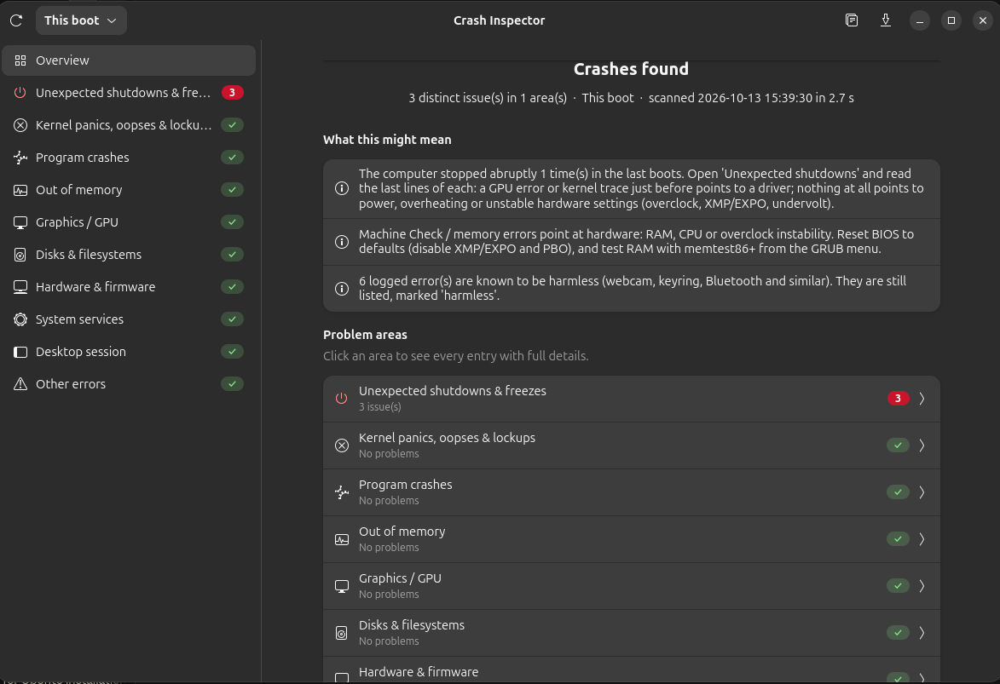

<div align="center">


# Crash Inspector

**Every crash and error on your Linux PC, in one window, explained in plain words.**

[](https://github.com/cyb3rl00m/crash-inspector/releases/latest)
[](LICENSE)


[](#credits)


[**Download**](https://github.com/cyb3rl00m/crash-inspector/releases/latest) ·
[Features](#features) ·
[Install](#install) ·
[Terminal mode](#terminal-mode) ·
[Report a bug](https://github.com/cyb3rl00m/crash-inspector/issues)

<br>



</div>

<br>

## Why Crash Inspector?

Your computer froze, rebooted by itself, or showed a black screen, and now you're supposed
to dig through dozens of `journalctl` commands to find out why.

**Crash Inspector does that for you.** It reads the system logs in a few seconds, sorts
everything into clear categories, filters out well-known harmless noise, and tells you what
the findings probably mean and what to try next.

> It was created to track down random freezes on a Ryzen PC, and it found the cause:
> a CPU **Machine Check** error logged right after every freeze.

## Features

| | Area | What it checks |
|:-:|---|---|
| ⏻ | **Unexpected shutdowns & freezes** | Boots that ended without a clean shutdown (hard freeze, kernel panic, power loss, failed wake-up), with the last log lines before the PC died. CPU hardware errors reported on the next boot are linked to the crash. |
| 🐧 | **Kernel panics & lockups** | Panics, Oops/BUG reports, kernel warnings with the responsible driver, soft/hard lockups, hung tasks, saved pstore panic logs |
| 💥 | **Program crashes** | Segfaults, systemd-coredump, Apport reports in `/var/crash` |
| 🧠 | **Out of memory** | Kernel OOM killer, systemd-oomd, earlyoom |
| 🎮 | **Graphics / GPU** | amdgpu, i915/xe, nouveau and NVIDIA errors, ring timeouts, GPU resets |
| 💾 | **Disks & filesystems** | I/O errors, SATA/NVMe problems, ext4/btrfs/xfs errors, read-only remounts |
| 🔧 | **Hardware & firmware** | Machine Check Exceptions, memory (EDAC) and PCIe errors, BIOS/ACPI, firmware, overheating, USB faults |
| ⚙️ | **System services** | Services that crashed or failed |
| 🖥️ | **Desktop session** | GNOME Shell, Xwayland, PipeWire, GDM… |
| ⚠️ | **Other errors** | Everything else logged as an error |

**Also included:**

- 💡 **Plain-language hints** on the Overview page: what's probably wrong and what to try
- ✅ **Harmless messages are recognised**: shown, but not counted as problems
- 🔁 **Duplicates merged** into one entry with a counter
- 🕒 **Time ranges**: this boot, previous boot, last 24 hours, 7 days or 30 days
- 📖 **Learn as you go**: every section shows the exact commands it ran
- 🛡️ **Share safely**: copied and exported reports hide your computer name, user name, IDs and IP/MAC addresses by default
- ⌨️ **Terminal mode** for when the desktop won't start

## Install

**Requirements:** Ubuntu 26.04 LTS, or another systemd-based distro with GTK 4 and libadwaita.

1. Download `crash-inspector.zip` from the [latest release](https://github.com/cyb3rl00m/crash-inspector/releases/latest) and unzip it.
2. Open a terminal in the unzipped folder and run:

   ```bash
   ./install.sh
   ```

3. Open **Crash Inspector** from your app grid.

| Task | Command |
|---|---|
| Update | Download the new release and run `./install.sh` again |
| Uninstall | `./install.sh --uninstall` |

> [!TIP]
> For complete results your user needs permission to read the system logs (the first user
> on Ubuntu has it by default). If the app shows a yellow banner, run
> `sudo usermod -aG adm $USER`, then log out and back in.

## Terminal mode

If the desktop won't start, switch to a text console with **Ctrl + Alt + F3**, log in, and run:

```bash
crash-inspector --text --range boot1 | less               # what happened in the previous boot
crash-inspector --text --range 7d --private > report.txt   # last 7 days, personal info hidden
```

| Option | Meaning |
|---|---|
| `--range boot0` | this boot (default) |
| `--range boot1` | previous boot (use this after a crash) |
| `--range 24h` / `7d` / `30d` | a time period |
| `--private` | hide personal info, for posting online |

## Optional extras

- `sudo apt install systemd-coredump` records a full stack trace for every program crash.
- `sudo apt install smartmontools` lets you check disk health (`sudo smartctl -a /dev/nvme0n1`).

## Privacy

Crash Inspector runs **entirely on your computer** and sends nothing anywhere. A report
leaves your PC only if you copy or export it yourself, and personal details are removed by
default (the 🛡️ shield button in the header bar toggles this).

## Contributing

Bug reports and ideas are very welcome! The most helpful contributions:

- **False alarms:** a harmless message shown as a problem? [Open an issue](https://github.com/cyb3rl00m/crash-inspector/issues/new) with the message text.
- **Missed problems:** a crash the app didn't catch? Attach the exported report (with "hide personal info" on).
- **Testing on other hardware and distros:** NVIDIA, Intel, laptops, Fedora, Arch…

## About

Crash Inspector is made by [**cyb3rl00m**](https://github.com/cyb3rl00m).

**AI disclosure:** the code and documentation were written with the help of Claude, an AI
assistant by Anthropic, and tested on real hardware by the author.

## License

Released under the [MIT License](LICENSE): free to use, change and share.

<div align="center">
<br>
<sub>If Crash Inspector helped you, consider giving it a ⭐ on GitHub. It helps other people find it.</sub>
</div>
